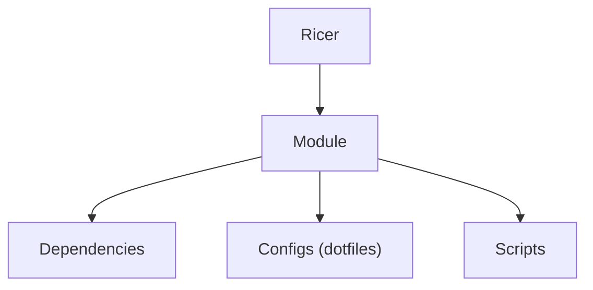

# Ricer

Linux rice manager utility.

Ricer is a script utility that provides a personal organization of grouped Linux dotfiles and scripts (modules) for management functionality like install, config, etc. How things are grouped depends on the user and the creator of the module.

## Concept



## Commands

| Command   | What it will do                                  | Status  |
|-----------|--------------------------------------------------|---------|
| `module`  | Create and manage modules                        | planned |
| `sync`    | Copy current system files into a module          | planned |
| `apply`   | Put a module's files in place on the system      | planned |
| `install` | Install the packages and deps a module needs     | planned |
| `run`     | Run a module's setup steps                       | planned |

## Module layout (planned)

A suggested standard for how a module can be laid out. The `desktop` module below is one possible solution; the final structure is up to the module's creator.

```
modules/
└── desktop/
    ├── deps/
    │   ├── pacman.txt
    │   └── module.txt
    ├── configs/
    │   ├── hyprland/
    │   ├── hyprpicker/
    │   └── .../
    └── desktop.sh
```

## Contributing

See [CONTRIBUTING.md](CONTRIBUTING.md) (coming soon).
